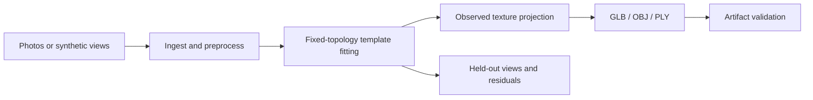
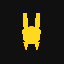

# OpenCat3D

**A CPU research prototype for reconstructing a fixed-topology cat avatar from multiple views, with inspectable geometry, texture provenance, and export validation.**

This portfolio snapshot packages an existing local project into a runnable source release. It includes the reconstruction pipeline, synthetic fixtures, evaluation tools, a local upload interface, and CatNet identity utilities. It excludes personal captures, downloaded model weights, runtime state, and the original automation workspace. See [PROVENANCE.md](PROVENANCE.md) for export changes.

## Engineering focus

- **One representation throughout:** a parameterized `CatTemplate`, with stable vertex/face topology, UVs, skeleton, and skin weights.
- **Inspectable fitting:** multi-view silhouette and keypoint objectives, finite loss histories, fitted safetensors, and per-view overlays. The current core optimizer uses NumPy finite differences.
- **Observed texture provenance:** projected basecolor with confidence and source-view maps; unobserved areas remain explicit. Neutral PBR companion maps are exported separately.
- **Portable assets:** OBJ, PLY, and textured/skinned/animated GLB, with reload, buffer-range, mesh, skeleton, and animation checks.
- **Evaluation within the pipeline:** held-out synthetic views, silhouette IoU, reprojection residuals, coverage reports, and acceptance audits.
- **Optional identity tools:** CatNet provides supervised projection/prototype utilities and versioned identity indexes. External pretrained backbones are optional adapters.



## Quick start

Python 3.11 or newer. The core demo requires no GPU, accounts, external APIs, or model-weight downloads.

```bash
python3 -m venv .venv
source .venv/bin/activate
python -m pip install -e '.[dev]'

# Generate synthetic observations, fit, export, and evaluate.
opencat3d run ./projects/demo_cat --mode synthetic --force

# Run the focused verified core checks.
python -m pytest tests/unit/test_schemas.py tests/unit/test_config_registry.py tests/unit/test_camera_conventions.py tests/unit/test_dense_evidence_adapters.py tests/unit/test_catnet_reid_training.py tests/unit/test_synthetic_generator.py tests/unit/test_export_mesh.py tests/unit/test_cli.py
```

The snapshot contains additional tests in `tests/`; the full suite was not re-run for this export. The command above passed 41 tests. A clean editable installation and 23 fast checks were also verified in a fresh Python 3.11 environment.

The pipeline writes `projects/demo_cat/outputs/`, including:

```text
fitting/fit_state.safetensors     Fitted geometry state
fitting/per_frame_overlay/       Per-view fit inspection
avatar/cat_avatar.glb            Textured, skinned asset
avatar/cat_canonical.obj         Canonical mesh
avatar/cat_canonical.ply         Canonical mesh
textures/                       Color, confidence, source-view and PBR maps
quality/                        Evaluation and validation reports
```

To use your own images locally:

```bash
opencat3d run ./projects/my_cat --mode raw --input ./photos --min-frames 2 --force
```

The raw segmentation/keypoint bootstrap is a simple starting point and can fail on cluttered backgrounds or occlusion. More photos do not by themselves establish accurate geometry. A local interface is available with `opencat3d serve --host 127.0.0.1 --port 8000 --work-dir ./web_runs`.

## Reproduced synthetic example

On 2026-10-26, the exported source completed a synthetic CPU run with three fitted views and one held-out evaluation view:

| Check | Result |
|---|---:|
| End-to-end pipeline | Passed |
| Synthetic acceptance checks | 19 / 19 |
| Initial / final fit loss | 11.8248 / 0.228973 |
| Held-out silhouette IoU | 0.813636 |
| Exported mesh vertices / faces | 958 / 1,864 |
| GLB structure, texture, skinning, animation checks | Passed |

The report is [examples/synthetic_result.json](examples/synthetic_result.json). The fixture uses the project's own simplified template and renderer. These values validate internal plumbing and a controlled fitting task; they do not measure accuracy on real cats or an external benchmark.



## Source map

| Directory | Responsibility |
|---|---|
| `src/opencat3d/ingest`, `preprocess` | Image/video ingestion and view preparation |
| `src/opencat3d/template`, `fitting` | Template geometry and fitting |
| `src/opencat3d/texture`, `export` | Texture provenance and asset export |
| `src/opencat3d/evaluation` | Residuals, held-out checks, acceptance, validation |
| `src/opencat3d/synthetic` | Deterministic synthetic fixtures and CPU rasterizer |
| `src/catnet` | Identity representation, indexes, and review utilities |
| `tests` | Reconstruction, geometry, export, provenance and identity checks |
| `models/registry.yaml` | Optional model/license metadata; no weights |

## Current limits

The template remains a simplified research representation. This release does not establish studio-quality avatars, real-world identity accuracy, large-scale model training, or novel multimodal/world-model performance. CatNet's default path uses supervised Fisher-style projection and prototypes. Optional adapter registry entries and configuration fields describe interfaces or planned backends; their presence does not mean those models are bundled or exercised by the core demo. In particular, the core fitting implementation should not be inferred from the scaffold's Adam/PyTorch3D configuration labels.

Local inputs can contain EXIF information and the pipeline preserves source material for provenance. Review generated artifacts before sharing them. This repository contains synthetic example output only.

## Rights

The existing [LICENSE](LICENSE) reserves rights pending a final licensing decision. Public visibility is not an open-source license. No third-party datasets, weights, checkpoints, or template assets are redistributed; see [THIRD_PARTY_NOTICES.md](THIRD_PARTY_NOTICES.md).
